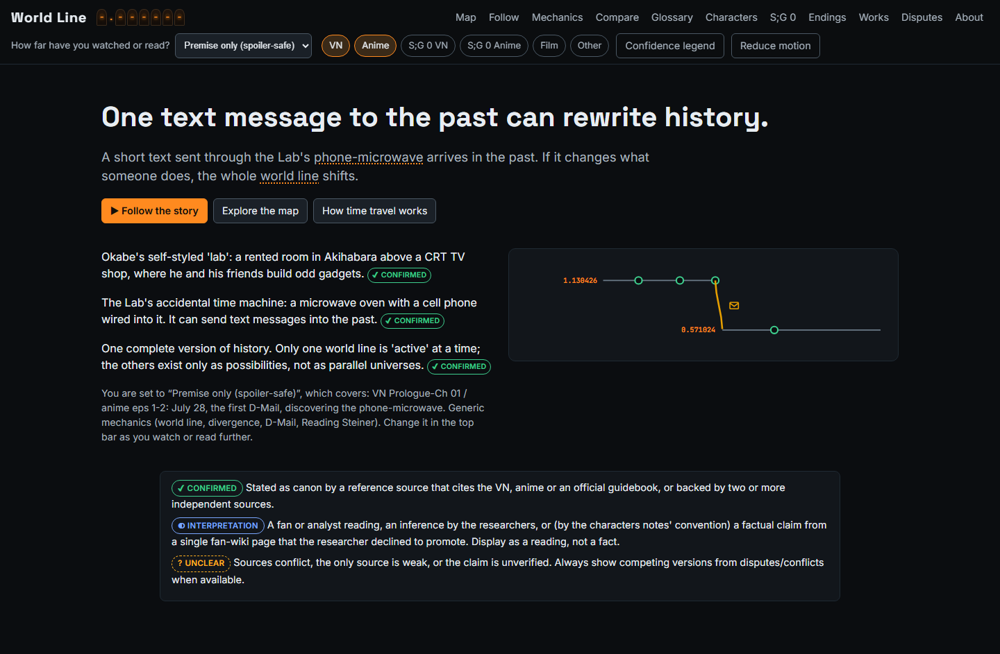
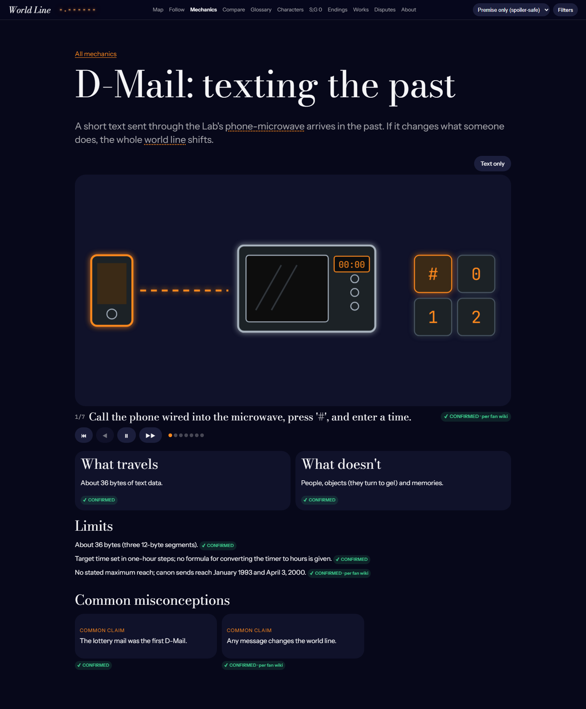

# World Line

**Live site:** https://0hbrar0.github.io/world-line/

An animated, interactive, spoiler-safe explainer of the Steins;Gate and Steins;Gate 0 story and time-travel mechanics, for first-time viewers. It is a static site with no runtime network requests, with two exceptions. Cloudflare Web Analytics counts visits on the live site only (no cookies, set by `VITE_ANALYTICS_TOKEN`). Creator Uplink contacts its small service in `uplink-service/` only when a visitor presses send. Set `VITE_UPLINK_URL` at build time to that service's address; the service reads `NTFY_BASE_URL`, `NTFY_TOPIC`, `NTFY_TOKEN` , `ALLOWED_ORIGINS` and optional `TURNSTILE_SECRET_KEY` from Railway and runs with `npm start` (root directory `uplink-service`, one instance). Two optional build settings: `VITE_TURNSTILE_SITE_KEY` adds a Cloudflare Turnstile check for visitors over their limit, loaded only at that moment, and `VITE_SUPPORT_URL` shows a "Support World Line" link in the panel. Every story fact comes from `data/canon.json` and shows a confidence badge that opens its sources. Unofficial fan project: no official art, screenshots, logos, music or script text.

**Screens:** world-line map, Follow the story (guided playback), six mechanic explainers, Compare, Glossary, Characters, S;G 0, Endings, Works, Disputes, About.





**Licence:** the code is under the [MIT licence](LICENSE). Steins;Gate and its characters belong to their owners; this project has no affiliation with them.

## How to run (Windows PowerShell)

```powershell
npm install
$env:PLAYWRIGHT_BROWSERS_PATH = "0"; npx playwright install chromium   # once, keeps the browser inside node_modules
npm run dev        # development server
npm run build      # validates canon.json, type-checks, builds to dist/
npm run preview    # serves dist/ at http://localhost:4173
```

Checks:

```powershell
npm run validate:canon
npm run lint
npm run test
npm run build
npx playwright test
py.exe scripts/reference/check_canon.py data/canon.json   # optional cross-check
npx tsx scripts/report-tier-leaks.ts                      # lists strings the tier guard trims
```

`dist/` is built with relative paths, so any static host works.

## Folder map

| Path | What it is |
|---|---|
| `data/canon.json` | Single source of truth for story data |
| `docs/` | UI spec (`visual-concept.md`), disputes and build requests (`open-questions.md`) |
| `research/` | Source list and research notes (reference only) |
| `src/app/` | App shell, hash router, settings, storage |
| `src/components/` | Badges, source drawer, Nixie display, top bar, term cards, glyphs |
| `src/data/` | Zod schema, loader, selectors, validator, tier guard, dispute links |
| `src/features/` | map, follow, mechanics, compare, glossary, sg0, characters, works |
| `src/styles/` | Tokens and styles |
| `scripts/` | Canon validator, tier-leak report, Python reference checker |
| `tests/` | Vitest: selectors, validator mutations, Python parity, token contrast |
| `e2e/` | Playwright specs. Screenshots land in `e2e/__screenshots__/`, which git ignores |
| `public/fonts/` | Self-hosted OFL fonts with their licences |
| `BUILD_PROMPT.md`, `CLAUDE.md` | Build brief and project rules |

## Build log

- **Phase 1 (scaffold):** Vite, React 18 and strict TypeScript in place; hash router, top bar, tier and media controls, Nixie readout, tokens, self-hosted OFL fonts, Playwright with two viewports. Chromium lives in node_modules so nothing lands outside the project.
- **Phase 2 (data layer):** strict Zod schema, selectors, and a validator with 34 mutation tests plus a parity test against the Python checker. Added a tier guard (`src/data/tierGuard.ts`) because canon.json tiers objects rather than strings: `npx tsx scripts/report-tier-leaks.ts` lists what it trims.
- **Phase 3 (map):** SVG world-line map with bands, the Steins Gate and S;G 0 lanes, mechanism-coded edges with hand-drawn icons, collapsed edges, the calendar and Okabe's order reflow, the July 28 day lens, range brackets, hover cards, detail panel, source drawer, zoom, pan, mini-map, keyboard navigation, list view and the mobile vertical timeline. Row heights are ordered rather than to scale, because lines like 1.130205 and 1.130212 would otherwise overlap.
- **Phase 4 (mechanics):** one `MechanicPlayer` drives six storyboards (33 frames) from `mechanics[].steps`, with per-step tier gating, a badge on every caption, a step list as the text alternative, text-only mode, reduced-motion stills, and flip cards for misconceptions. `visualHint` guides the drawings and is never shown; a test checks this.
- **Phase 5 (Follow the story):** playback over visible events in either order, camera moves, edge draw-on, Nixie roll, narration from canon plus unlocked reveals, keyboard and speed controls, mechanic interludes, tier walls and saved progress. Stepping at every tier was tested for leaks.
- **Phase 6 (Compare):** picker, real table with scoped headers, fates only from `aliveDead`, path strip over directed transitions, swipeable columns on mobile.
- **Phase 7 (Glossary):** tier-safe fuzzy search, category chips, entry pages, `<Term>` hover and focus cards, Real world tag.
- **Phase 8 (S;G 0 and the rest):** `#/sg0` locked below `sg0`, with the fork diagram, the loop-back animation and its text alternative, ending tiles, a choice tree parsed from `howToReach`, and the anime and VN list. Also added Endings, Characters, Works, Disputes and About.
- **Phase 9 (polish):** axe reports no serious or critical issues on all 15 routes at the premise and extras tiers, at both widths, nor with the source drawer open. Added focus traps with focus restore, a skip link that works with hash routing, token contrast tests, checks for no sideways scroll at 200% zoom and tablet width, and the About disclaimer. Panning the map at the extras tier measured a median frame of 16.7 ms and p95 of 16.7 ms in headless Chromium on this machine.

## Unresolved

**Requests logged in `docs/open-questions.md`:**
1. 39 canon strings name later content than their own tier. canon.json was left unedited, and the tier guard trims them in the UI. The table lists each one.
2. Mechanic summaries have no sources or confidence of their own. `oneLiner` shows no badge; `whatTravels` and `whatDoesNotTravel` borrow from their steps.
3. Works have no spoiler tier, so the UI uses a rule of its own.
4. Disputes have no link to the objects they concern, and sources have no tier.
5. Fixed-point events are listed by hand for the knot glyph.

**Spec differences and known limitations:**

- Character pictures: each character has an original drawn poster (a faceless silhouette, not their real design). An image added to `src/assets/characters/` (see the README there) replaces it on the tile and character page.
- The spoiler control is a dropdown, not a segmented control: six long labels do not fit in the top bar.
- The look departs from `docs/visual-concept.md`: editorial type (Bodoni Moda, Instrument Sans), a scroll-driven home page, and each section has its own colour world. Follow the story is real-time 3D (three.js, loaded only on that page) with three views: Both 3D views now sit in a real-time space scene with Earth (continents, clouds, city lights), a space station, satellites and, as a prototype, household objects drifting off the planet. Point at a floating object to outline it, left-click for why it left Earth, and right-click to blow it up. Rockets launch now and then; right-clicking one ends the world, briefly. Mars sits near Earth in Observer, with a tiny Elon hammering at a crate beside a parked rocket and a white roadster that fires its thrusters, hops and lands, while an old TV shows it live (all original art, no logos or real photos); he has his own jokes and comes back if destroyed. Hover Mars for a scroll hint: scrolling up carries the camera down to the planet, and you can stop at any distance. Up close you watch him in 3D at one of four silly jobs; scrolling up again moves to the next, and scrolling down pulls back. The Settings button beside Filters turns these on and off and holds the other personal options. The scene also has a painted nebula, lit planets with computed ring and planet shadows, asteroids, a sun and light rays. Observer (the default) looks through the eyes of a colossal being whose head turns to follow the line across a galaxy; Flight rides along the line, with world-line jumps warping the camera; Chart is the flat map, used automatically when motion is reduced or WebGL is missing. The map and every Follow view share glass player controls (back, play, next, pace), and on the map that bar holds the overview strip.
- Media chips, the confidence legend and Reduce motion sit in a Filters popover at every width, not only below 1280 px.
- The S;G 0 page is split into four tabs rather than one long scroll.
- Hovering the map fades everything except the hovered world line and its edges.
- Phones, tablets and browsers without a graphics chip get a one-time notice on the first visit explaining what they will miss.
- Map zoom uses the wheel, keyboard and on-screen buttons, and scales the map like a picture: the layout never changes, and dragging moves it in both directions. With the whole story in view the small icons and brackets fade out and return on zooming in. Pinch zoom is not implemented.
- Map row heights are ordered, not to scale, because lines that differ only in the last digits would overlap. The S;G 0 lane sits above the Beta band instead of inside it.
- Edges are reached with the E key from a node, or by mouse. They are not Tab stops.
- Peek ("Reveal this fact") works for `reveals` only.
- The Disputes page lists items the UI omits elsewhere, such as Kurisu's age and the meter's invention year, because that page exists to show them.
- The full canon.json ships inside the JavaScript bundle. Locked content is never in the DOM, but someone reading the bundle can find it.
- The tier guard matches names and values. It cannot catch a spoiler written with no locked name in it, so canon tiers remain the real gate.
- Mobile hit targets were checked by CSS rules, not measured per element.
- The performance figure comes from one machine in headless Chromium, not from mid-range hardware. 200% zoom was tested as a 720×450 viewport, not with browser zoom.
- Screen readers were not tested by hand; accessibility evidence is axe plus keyboard tests.
- Source content was not rechecked in this build. Existing research gaps stay in `docs/open-questions.md`.
