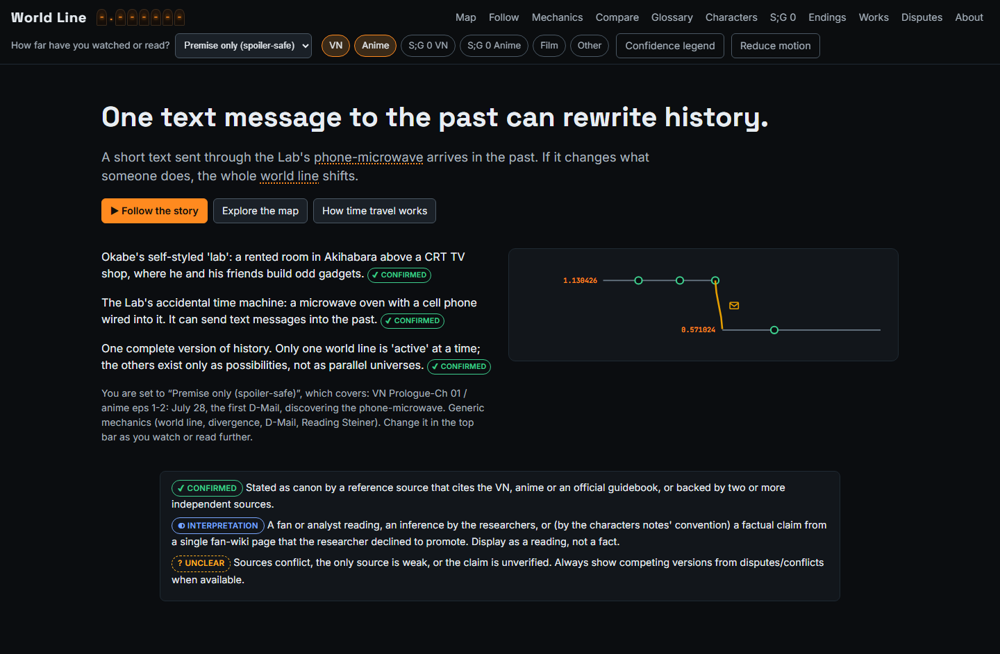
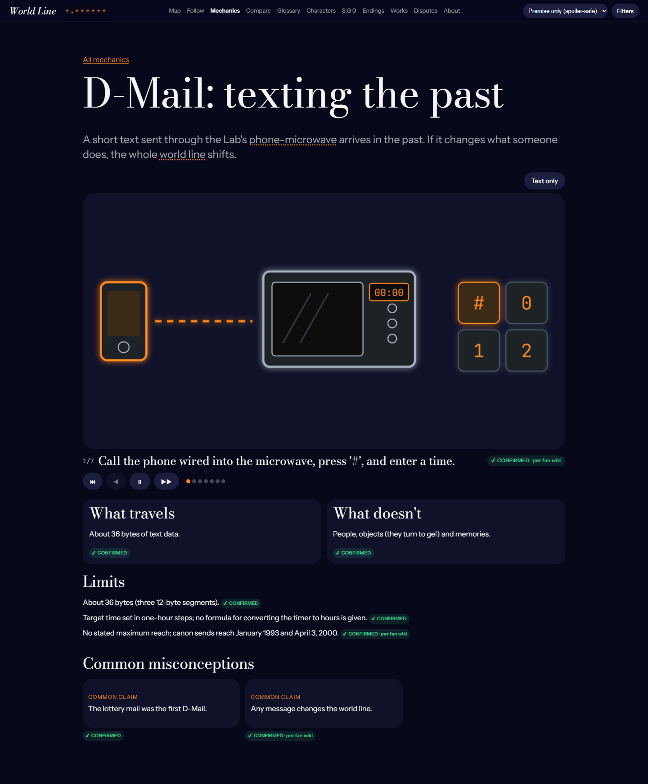

# World Line

**Live site:** https://0hbrar0.github.io/world-line/

An animated, interactive, spoiler-safe explainer of the Steins;Gate and Steins;Gate 0 story and time-travel mechanics, for first-time viewers. It is a static site with no runtime network requests, with two exceptions. Cloudflare Web Analytics counts visits on the live site only (no cookies, set by `VITE_ANALYTICS_TOKEN`). Creator Uplink contacts its small service in `uplink-service/` only when a visitor presses send. Set `VITE_UPLINK_URL` at build time to that service's address; the service reads `NTFY_BASE_URL`, `NTFY_TOPIC`, `NTFY_TOKEN` , `ALLOWED_ORIGINS` and optional `TURNSTILE_SECRET_KEY` from Railway and runs with `npm start` (root directory `uplink-service`, one instance). Two optional build settings: `VITE_TURNSTILE_SITE_KEY` adds a Cloudflare Turnstile check for visitors over their limit, loaded only at that moment, and `VITE_SUPPORT_URL` shows a "Support World Line" link in the panel. Every story fact comes from `data/canon.json` and shows a confidence badge that opens its sources. Unofficial fan project: no official art, screenshots, logos, music or script text.

**Screens:** The chronicle (the story as world-line blocks with one numbered jump between them), World lines (the full chart), D-Mails (every D-Mail as a file), six time-travel explainers, Compare, Glossary, Characters, S;G 0, Endings, Works, Fan debates, About.





**Licence:** the code is under the [MIT licence](LICENSE). Steins;Gate and its characters belong to their owners; this project has no affiliation with them.

## How to run (Windows PowerShell)

```powershell
npm install
$env:PLAYWRIGHT_BROWSERS_PATH = "0"; npx playwright install chromium   # once, keeps the browser inside node_modules
npm run dev        # development server
npm run build      # validates canon.json, type-checks, builds to dist/
npm run preview    # serves dist/ at http://localhost:4173
```

Checks:

```powershell
npm run validate:canon
npm run lint
npm run test
npm run build
npx playwright test
py.exe scripts/reference/check_canon.py data/canon.json   # optional cross-check
npx tsx scripts/report-tier-leaks.ts                      # lists strings the tier guard trims
```

`dist/` is built with relative paths, so any static host works.

## Folder map

| Path | What it is |
|---|---|
| `data/canon.json` | Single source of truth for story data |
| `docs/` | UI spec (`visual-concept.md`), disputes and build requests (`open-questions.md`) |
| `research/` | Source list and research notes (reference only) |
| `src/app/` | App shell, hash router, settings, storage |
| `src/components/` | Badges, source drawer, Nixie display, top bar, term cards, glyphs |
| `src/data/` | Zod schema, loader, selectors, validator, tier guard, dispute links |
| `src/features/` | map, follow, mechanics, compare, glossary, sg0, characters, works |
| `src/styles/` | Tokens and styles |
| `scripts/` | Canon validator, tier-leak report, Python reference checker |
| `tests/` | Vitest: selectors, validator mutations, Python parity, token contrast |
| `e2e/` | Playwright specs. Screenshots land in `e2e/__screenshots__/`, which git ignores |
| `public/fonts/` | Self-hosted OFL fonts with their licences |
| `BUILD_PROMPT.md`, `CLAUDE.md` | Build brief and project rules |

## Build log

- **Phase 1 (scaffold):** Vite, React 18 and strict TypeScript in place; hash router, top bar, tier and media controls, Nixie readout, tokens, self-hosted OFL fonts, Playwright with two viewports. Chromium lives in node_modules so nothing lands outside the project.
- **Phase 2 (data layer):** strict Zod schema, selectors, and a validator with 34 mutation tests plus a parity test against the Python checker. Added a tier guard (`src/data/tierGuard.ts`) because canon.json tiers objects rather than strings: `npx tsx scripts/report-tier-leaks.ts` lists what it trims.
- **Phase 3 (map):** SVG world-line map with bands, the Steins Gate and S;G 0 lanes, mechanism-coded edges with hand-drawn icons, collapsed edges, the calendar and Okabe's order reflow, the July 28 day lens, range brackets, hover cards, detail panel, source drawer, zoom, pan, mini-map, keyboard navigation, list view and the mobile vertical timeline. Row heights are ordered rather than to scale, because lines like 1.130205 and 1.130212 would otherwise overlap.
- **Phase 4 (mechanics):** one `MechanicPlayer` drives six storyboards (33 frames) from `mechanics[].steps`, with per-step tier gating, a badge on every caption, a step list as the text alternative, text-only mode, reduced-motion stills, and flip cards for misconceptions. `visualHint` guides the drawings and is never shown; a test checks this.
- **Phase 5 (Follow the story):** playback over visible events in either order, camera moves, edge draw-on, Nixie roll, narration from canon plus unlocked reveals, keyboard and speed controls, mechanic interludes, tier walls and saved progress. Stepping at every tier was tested for leaks.
- **Phase 6 (Compare):** picker, real table with scoped headers, fates only from `aliveDead`, path strip over directed transitions, swipeable columns on mobile.
- **Phase 7 (Glossary):** tier-safe fuzzy search, category chips, entry pages, `<Term>` hover and focus cards, Real world tag.
- **Phase 8 (S;G 0 and the rest):** `#/sg0` locked below `sg0`, with the fork diagram, the loop-back animation and its text alternative, ending tiles, a choice tree parsed from `howToReach`, and the anime and VN list. Also added Endings, Characters, Works, Disputes and About.
- **Phase 9 (polish):** axe reports no serious or critical issues on all 15 routes at the premise and extras tiers, at both widths, nor with the source drawer open. Added focus traps with focus restore, a skip link that works with hash routing, token contrast tests, checks for no sideways scroll at 200% zoom and tablet width, and the About disclaimer. Panning the map at the extras tier measured a median frame of 16.7 ms and p95 of 16.7 ms in headless Chromium on this machine.

## Unresolved

**Requests logged in `docs/open-questions.md`:**
1. 39 canon strings name later content than their own tier. canon.json was left unedited, and the tier guard trims them in the UI. The table lists each one.
2. Mechanic summaries have no sources or confidence of their own. `oneLiner` shows no badge; `whatTravels` and `whatDoesNotTravel` borrow from their steps.
3. Works have no spoiler tier, so the UI uses a rule of its own.
4. Disputes have no link to the objects they concern, and sources have no tier.
5. Fixed-point events are listed by hand for the knot glyph.

**Spec differences and known limitations:**

- Character pictures: each character has an original file card with their initials until a picture is added to `src/assets/characters/`.
- The spoiler control is a dropdown, not a segmented control: six long labels do not fit in the top bar.
- Version 3 look: washed-out paper, black ink and one red, with gears and Roman-numeral clocks turning behind the pages. The Nixie tubes and the old screens are the only dark, lit things. Type is Courier Prime, Special Elite and Barlow Condensed (`src/styles/steins.css`). This departs from `docs/visual-concept.md`.
- Built with AI: the code, research and much of the writing were made with Claude, directed by a fan. The About page says so too.
- Media chips, the confidence legend and Reduce motion sit in a Filters popover at every width, not only below 1280 px.
- The S;G 0 page is split into four tabs rather than one long scroll.
- Hovering the map fades everything except the hovered world line and its edges.
- Phones and tablets get a one-time notice on the first visit: the chart views need a bigger screen and a mouse.
- The chronicle (`#/follow`) replaces the old step player. Each block is one world line; each coloured band between blocks is the jump that led to the next: D-Mail, D-Mail cancellation, time leap, time machine or database erasure, numbered in the order Okabe lived them. A side panel shows the divergence now, a story clock set to the open step's sourced time, and the route so far.
- A time leap stays on its world line, so canon has no transition for it. The chronicle marks leap steps by event id (`LEAPS` in `FollowPage.tsx`); see request 6 in `docs/open-questions.md` for the dates canon lacks.
- Motion: a short burst of static plays when the story lands on another world line, the phone on the home page buzzes, and the gears turn. All of it stops under Reduce motion.
- Motion: the clockwork behind every page (`Backdrop` in `src/components/GearClock.tsx`) is made of separate wheels that step on a shared beat, and small details (`src/components/Motifs.tsx`, the end of `src/styles/steins.css`) play once when something happens. Every animation is gated on `html[data-motion='full']`, so the Motion setting and the device setting turn all of it off. The approved prototype is `docs/motion/prototype.html`.
- Mechanic animations (`src/features/mechanics/scene.tsx` for the props, `storyboards.tsx` for one frame per canon step) are ink diagrams on graph paper. One rule runs through them: ink is how things were, red is what travels or changes. Labels use only diagram words or words from the step's caption.
- On phones the top bar puts the name and menus on one line with the spoiler picker full width under them, and the world lines map is drawn top to bottom (`RopeLadder.tsx`).
- The world lines map is The Rope: world lines are threads, attractor fields are ropes that end in a knot, and the one red strand is the path lived, with hops numbered as in the Chronicle. The framework and its vocabulary are in `docs/rope-map.md`.
- Source notes are off by default. The Sources button in the top bar shows the confidence badges, the source drawer, which translation a D-Mail's wording is from, map confidence marks and the "where sources disagree" notes; the choice is remembered. Gate anything of that kind with `useShowSources()` from `src/app/settings.tsx`.
- Secrets: a few things a fan might try are listed in `docs/secrets.md`. Each one opens only what the visitor's spoiler level already allows.
- D-Mail files show the date sent, where it lands, who is involved, what happened and what it changed. Five D-Mails also show their wording (`dmailText` on the event), quoted from a source and labelled with which telling and translation it is: the on-screen text is Japanese, so English wording differs between translations. The other D-Mails have no quotable wording in the sources checked (several are never shown in the story) and say so; see request 7 in `docs/open-questions.md`.
- Map zoom uses the wheel, keyboard and on-screen buttons, and scales the map like a picture: the layout never changes, and dragging moves it in both directions. With the whole story in view the small icons and brackets fade out and return on zooming in. Pinch zoom is not implemented.
- Map row heights are ordered, not to scale, because lines that differ only in the last digits would overlap. The S;G 0 lane sits above the Beta band instead of inside it.
- Edges are reached with the E key from a node, or by mouse. They are not Tab stops.
- Peek ("Reveal this fact") works for `reveals` only.
- The Disputes page lists items the UI omits elsewhere, such as Kurisu's age and the meter's invention year, because that page exists to show them.
- The full canon.json ships inside the JavaScript bundle. Locked content is never in the DOM, but someone reading the bundle can find it.
- The tier guard matches names and values. It cannot catch a spoiler written with no locked name in it, so canon tiers remain the real gate.
- Mobile hit targets were checked by CSS rules, not measured per element.
- The performance figure comes from one machine in headless Chromium, not from mid-range hardware. 200% zoom was tested as a 720×450 viewport, not with browser zoom.
- Screen readers were not tested by hand; accessibility evidence is axe plus keyboard tests.
- Source content was not rechecked in this build. Existing research gaps stay in `docs/open-questions.md`.
